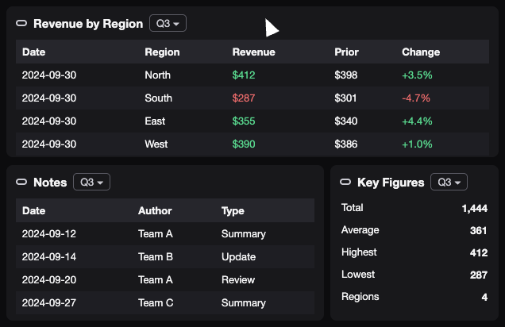

<h1 align="center">
  
</h1>

**[Run it on your machine](docs/technical-guide/build-from-source/run-the-stack-from-source.md)** · [User Guide](docs/user-guide/index.md) · [Technical Guide](docs/technical-guide/index.md) · [Reference](docs/reference/index.md) · [FAQ](docs/faq/index.md) · [Plugins](docs/plugins/index.md) · [Contribute](docs/contributing/index.md)

  

Users connect their own data backends and arrange the data in dashboards of widgets. An AI agent answers questions about the dashboards, outside AI tools reach them through an MCP server, roles decide who may use what, and plugins add new kinds of widgets.

The code is in `frontend/`, `backend-api/`, `agent/` (Ines and its MCP server), `local/` (the development stack) and `docs/` with `website/` (the documentation). Licensed under the Apache License 2.0; see [LICENSE](LICENSE) and [NOTICE](NOTICE).
