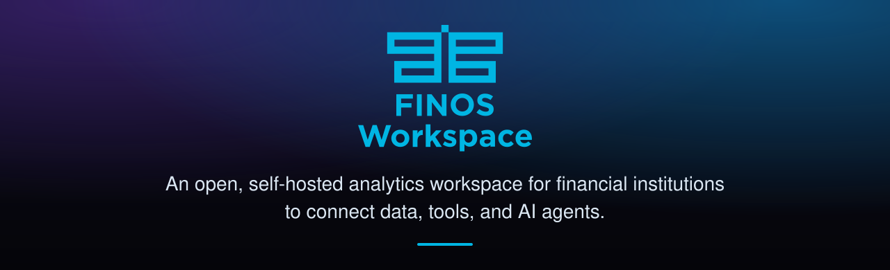
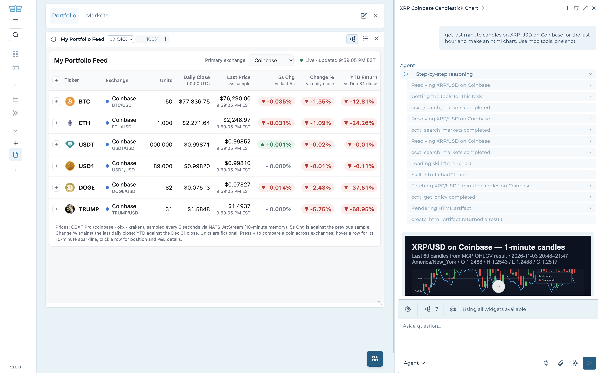

[](https://community.finos.org/docs/governance/lifecycle-stages/labs)

<h1 align="center">
  
</h1>

<p align="center">
  An open, self-hosted analytics workspace for financial institutions to connect data, tools, and AI agents.
</p>

<div align="center">

**Documentation: [workspace.finos.org](https://workspace.finos.org)**

[Quick start](https://workspace.finos.org/quick-start) · [Features](https://workspace.finos.org/features) · [Tutorials](https://workspace.finos.org/tutorials) · [Reference](https://workspace.finos.org/reference)

</div>

<p align="center">
  
</p>

## What is FINOS Workspace?

FINOS Workspace is a web app that you run on your own servers. You connect your own data, put it on dashboards, and ask an AI agent questions about what you see. Your data and your keys stay in your deployment.

## Documentation

Everything about FINOS Workspace is at **<https://workspace.finos.org>**: how to use it, how to connect your data, how to deploy it, and the full reference. This README gives only a short overview.

The docs are built from the Markdown and MDX in [`docs/`](docs/) with Docusaurus in [`website/`](website/); to read them as a website on your computer, see [website/README.md](website/README.md).

## Quick start

You need Docker with Docker Compose, Python 3, and a GitHub personal access token (classic) with the `read:packages` scope.

```bash
# 1. Get the code
git clone https://github.com/finos-labs/finos-workspace.git
cd finos-workspace

# 2. Log in to the GitHub container registry (once)
echo <token> | docker login ghcr.io -u <github-username> --password-stdin

# 3. Write the local settings and secrets
(cd backend-api/backend && python3 -m scripts.create_local_env --admin-email <your-email>)

# 4. Start everything (on Apple silicon: PLATFORM=linux/arm64 docker compose up --build)
docker compose up --build

# 5. In a second terminal, when the stack is up, set your password
docker compose run --rm init python -m scripts.init_users --new-password <your-email>
```

Open <http://localhost:3000> and sign in with your email address and password.

To let the AI agent answer questions, set `DEFAULT_MODEL` and your model provider's API key in `agent/.env`, then run `docker compose up -d`.

To pull the images from Docker Hub instead of building them, which needs no token, follow the [Quick start guide](https://workspace.finos.org/quick-start?images=docker-hub).

The [Quick start guide](https://workspace.finos.org/quick-start) continues from here: you write a small data backend and put its first widget on a dashboard.

## Container images

Each release publishes the four images on Docker Hub, built for `linux/amd64` and tagged with the release's tag: [`finos/workspace-backend`](https://hub.docker.com/r/finos/workspace-backend), [`finos/workspace-web`](https://hub.docker.com/r/finos/workspace-web), [`finos/workspace-agent`](https://hub.docker.com/r/finos/workspace-agent) and [`finos/workspace-agent-mcp`](https://hub.docker.com/r/finos/workspace-agent-mcp). [Deploy with Docker Compose](https://workspace.finos.org/tutorials/deploy/deploy-with-docker-compose) and [Deploy on Kubernetes](https://workspace.finos.org/tutorials/deploy/deploy-on-kubernetes) show how to run them.

## Features

| Feature | What it does |
|---|---|
| [Dashboards](https://workspace.finos.org/features/dashboards/create-and-arrange-dashboards) | Arrange widgets on a page, group dashboards in folders, and export them. |
| [Widgets](https://workspace.finos.org/features/widgets/widget-types) | Show tables, charts, Markdown, HTML, PDFs, news and embedded pages. |
| [Data backends](https://workspace.finos.org/features/data-backends/connect-a-backend) | Connect your own data sources. |
| [Apps](https://workspace.finos.org/features/apps/browse-and-open-apps) | Save a dashboard as an app that other people can open. |
| [Agent](https://workspace.finos.org/features/agent/ask-the-agent-about-a-dashboard) | Ask questions about a dashboard, with your choice of model and tools. |
| [MCP Companion](https://workspace.finos.org/features/mcp-companion) | Let AI tools, such as your IDE, build dashboards and apps for you. |
| [Sharing](https://workspace.finos.org/features/sharing/share-a-dashboard) | Share dashboards with your team. |
| [Administration](https://workspace.finos.org/features/administration/add-a-user) | Manage users, roles and access to data. |
| [White label](https://workspace.finos.org/features/white-label) | Use your own name, logos, colors and fonts. |
| [Plugins](https://workspace.finos.org/features/plugins) | Add new kinds of widgets. |

New to the terms? [Concepts](https://workspace.finos.org/concepts) explains what a dashboard, a widget, a backend and an app are. [All features](https://workspace.finos.org/features) has the complete list.

## Tutorials

To learn by doing, follow the [tutorials](https://workspace.finos.org/tutorials) in the documentation. They show how to build a data backend, write your own agent, build a widget plugin, deploy FINOS Workspace for your organization, and contribute to the project.

## Advisory Committee

An Advisory Committee has been formed to ensure the roadmap reflects the needs of buy-side and sell-side institutions. The committee brings together maintainers, global banks, and consultancy partners to guide architectural decisions and open-standards integration. The current members are listed below:

- Alexandru Dumitru, Engineering Lead, Global UI Platform at Citi
- Kris West, FDC3 Lead Maintainer
- Chris Watson, Lead Sail Maintainer and Head of Interoperability at AlphaFMC
- Jorge Vasquez, Global Product Manager, Bank of America

## Get involved

- Subscribe to the FINOS Workspace mailing list by sending an email to  `workspace-dev+subscribe@lists.finos.org`
- Intrested in joining the advisory committe? Email [workspace-dev@lists.finos.org](mailto:workspace-dev@lists.finos.org) about joining.

## License

Copyright 2026 FINOS

Distributed under the [Apache License, Version 2.0](http://www.apache.org/licenses/LICENSE-2.0).

SPDX-License-Identifier: [Apache-2.0](https://spdx.org/licenses/Apache-2.0)

Individual components may carry additional notices in their own directories.
