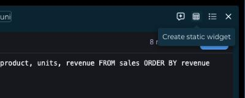
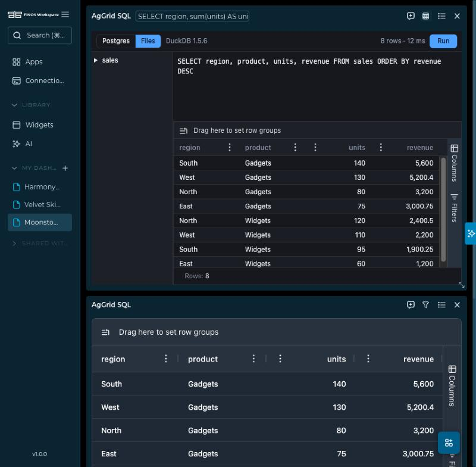
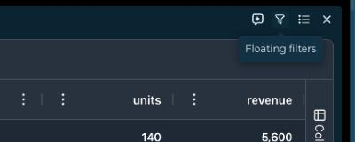
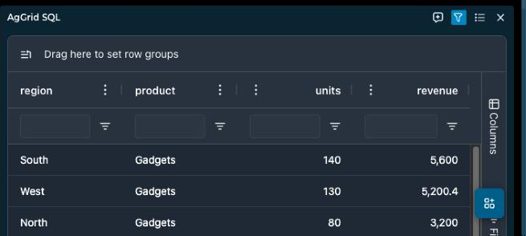
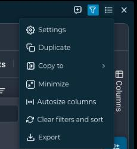

# AgGrid table for FINOS Workspace

A FINOS Workspace widget plugin that renders the `ag-grid` widget type with
[AG Grid](https://www.ag-grid.com/), configured the way
[OpenBB Workspace's table widget](https://docs.openbb.co/workspace/developers/widget-types/aggrid-table-charts)
is: column definitions, render functions, hover cards, sparklines and ChartView. It is an example in the repository's `docs/examples/`, a package of
its own that nothing in FINOS Workspace imports, built and deployed the way any
plugin is ([AUTHORING.md](../../widget-plugins/AUTHORING.md)).

## What it shows

The plugin renders tabular data returned by a backend as an ag-grid Community
table, with:

- **Column definitions**: `field`, `headerName`, `width`, `minWidth`, `maxWidth`,
  `flex`, `resizable`, `sortable`, `filter`, `editable`, `pinned`, `rowGroup`,
  `enablePivot`, `cellRenderer`, `cellEditor`, `valueGetter`, `valueSetter`,
  `cellClass`, `cellStyle`, `tooltip`, and more.
- **Grid options**: `rowSelection` (`single`/`multiple`), `rowMultiSelectWithClick`,
  `rowDeselection`, `pagination` / `paginationPageSize`, `domLayout`
  (`autoHeight`), `editing` (`singleCell`/`fullRow`), `enableRangeSelection`,
  `suppressContextMenu`, `animateRows`, `enableCellTextSelection`, `rowHeight`,
  `headerHeight`, `treeData`, `masterDetail`, and many others.
- **Streaming updates**: when the backend pushes new row data through the
  `data` trait, the widget computes an add/update/remove diff and applies it
  with `api.applyTransaction()` — efficient incremental updates without a full
  re-render. Falls back to `api.setRowData()` if transactions fail.
- **Grid events**: `selectionChanged`, `cellValueChanged`, `rowDataChanged`,
  `filterChanged`, `sortChanged`, `columnResized`, `columnMoved`, `cellClicked`
  are recorded to the widget's `state` trait (written back to the host via
  `model.save_changes()`) and exposed through `copilotContext()` so the AI
  agent can read them.
- **Export**: CSV export of the visible rows (`core:export:provide`).
- **Themes**: follows the site's `theme=dark` / `theme=light` using
  `ag-theme-quartz` / `ag-theme-quartz-dark`, in a compact density: 26 px rows, a 30 px header,
  formatted and right-aligned numbers, columns that share the card's width, and pagination only
  above 100 rows, with as many rows per page as fit.
- **Tool panels**: with `ag-grid-enterprise` loaded, a side bar with the Columns panel
  (visibility, row groups, values and Pivot Mode) and the Filters panel, drop zones for row
  groups and pivots, range selection and a status bar with the row count and the aggregate of
  the selected cells. Every column can be grouped, pivoted and aggregated, and a selected range
  is charted from the context menu (Chart Range: column, bar, pie, line, scatter, area, statistical
  and combination charts) in a dark or light chart theme that follows the site. A backend's
  `gridOptions` replace any of these defaults.

## The contract

The backend declares a widget of type `ag-grid` and returns JSON:

```json
{
  "sales": {
    "name": "Sales by region",
    "type": "ag-grid",
    "endpoint": "/sales"
  }
}
```

The endpoint returns JSON at the `dataKey` path. `dataKey` is set in
`widgets.json` as a dot-notation path into the API response (e.g.
`"results.grid"`). The host extracts the value at that path and delivers it to
the plugin through the `data` trait.

### 1. ag-grid-ready object (explicit column defs)

```json
{
  "columnDefs": [
    { "field": "region", "headerName": "Region", "width": 150 },
    { "field": "sales", "headerName": "Sales", "width": 100 }
  ],
  "rowData": [
    { "region": "EMEA", "sales": 100 },
    { "region": "APAC", "sales": 105 }
  ],
  "gridOptions": {
    "rowSelection": "multiple",
    "pagination": true,
    "paginationPageSize": 20
  }
}
```

### 2. List of records (pandas `to_dict('records')`)

```json
[
  { "region": "EMEA", "sales": 100, "date": "2024-01-10" },
  { "region": "APAC", "sales": 105, "date": "2024-01-12" }
]
```

Column definitions and types are inferred automatically from the data.

### 3. Dict of columns (pandas `to_dict('list')`)

```json
{
  "region": ["EMEA", "APAC"],
  "sales": [100, 105],
  "date": ["2024-01-10", "2024-01-12"]
}
```

### 4. Pandas split format

```json
{
  "columns": ["region", "sales", "date"],
  "index": [0, 1],
  "data": [["EMEA", 100, "2024-01-10"], ["APAC", 105, "2024-01-12"]]
}
```

### 5. Grouping

Column definitions in the ag-grid-ready object group rows. Here the `region` column is the row
group and is hidden as a column of its own:

```json
{
  "columnDefs": [
    { "field": "region", "rowGroup": true, "hide": true },
    { "field": "sales" }
  ],
  "rowData": [
    { "region": "EMEA", "sales": 100 },
    { "region": "APAC", "sales": 105 }
  ]
}
```

## Table chart configuration

An OpenBB backend's table widget moves over with two changes: `"type": "table"` becomes
`"type": "ag-grid"`, and `data.table` becomes `data["ag-grid"]`. The endpoint returns the same
rows. The plugin declares the object's schema (`definition` in `plugin.json`), so a backend whose
keys or values do not fit sees the problem, with its JSON pointer, when it connects.

```json
{
  "assets": {
    "name": "Assets",
    "description": "TVL by asset",
    "type": "ag-grid",
    "endpoint": "/assets",
    "data": {
      "ag-grid": {
        "enableCharts": true,
        "chartView": { "enabled": false, "chartType": "column" },
        "columnsDefs": [
          { "field": "name", "headerName": "Asset", "renderFn": "titleCase", "pinned": "left", "chartDataType": "category" },
          { "field": "tvl", "headerName": "TVL (USD)", "formatterFn": "int", "chartDataType": "series" },
          { "field": "change_1d", "headerName": "24h Change", "formatterFn": "percent", "renderFn": "greenRed" }
        ]
      }
    }
  }
}
```

| Key (as in OpenBB) | What the plugin does |
|---|---|
| `columnsDefs[]`: `field`, `headerName`, `headerTooltip`, `width`, `minWidth`, `maxWidth`, `hide`, `pinned`, `align` | The AG Grid column options of the same names. A column with `width` keeps it instead of sharing the card's width. |
| `cellDataType` (`text`, `number`, `boolean`, `date`, `dateString`, `object`) | The column's filter, alignment and formatting. Without it, the type is inferred from the rows. Date strings sort, filter and chart as dates and show as they came. |
| `formatterFn` (`int`, `none`, `percent`, `normalized`, `normalizedPercent`, `dateToYear`), on a column or the whole table; `decimalPlaces`; `prefix`, `suffix` | Formatted cell text. Sorting, filtering, charts and the CSV keep the raw values. Numbers follow the site's locale and decimals. |
| `renderFn` (one or a list) and `renderFnParams` | `greenRed`, `titleCase`, `columnColor` (`colorRules` with every condition, `fill`, `colorValueKey`), `hoverCard` (`cellField`, `title`, `markdown` with `{field}` placeholders, or `hoverCardData`), `cellOnClick` (below) and `showCellChange` (below). |
| `sparkline` (`line`, `area`, `bar`; `dataField`; `options`) | AG Grid sparklines: stroke, fill, opacity, markers, padding, bar `direction`, `min`/`max` for bars, every point of interest, and `customFormatter`. |
| `chartDataType` (`category`, `series`, `time`, `excluded`) | The column's role in charts. |
| `showAll` | Default `true`: fields the rows have and `columnsDefs` does not are shown after the declared ones. `false` shows only `columnsDefs`. |
| `transpose` | One row per column and one column per row, headed by the first column's values. Each cell keeps its column's format and colours. |
| `enableCharts`, `chartView` (`enabled`, `chartType`, `cellRangeCols`, `ignoreCellRange`, `chartNavigatorEnabled`, `chartMiniChartEnabled`) | A *Table / Chart* toolbar and an AG Grid integrated chart linked to the rows, with every chart type of OpenBB's list. The chart a user arranges is saved with the dashboard and restored, unless `ignoreCellRange`. Right-click *Chart Range* charts any selection. `enableCharts: false` turns charting off. |
| `enableAdvanced` | `true` opens the Columns panel; `false` hides the side bar. |
| `wsRowIdColumn` | The field that identifies a row across refreshes (default `id`), so changed rows are applied as transactions and `showCellChange` knows which cell moved. |

**Cell clicks** (`renderFn: "cellOnClick"`):

- `actionType: "groupBy"` writes `groupBy.paramName` (the cell's value, or the row's `valueField`) to the widget's params, which also updates every widget grouped with that param. The param must be one the widget declares in `widgets.json`. The widget always refetches, as with `forceUpdate: true`.
- `actionType: "openUrl"` opens the cell's value, or `renderFnParams.url` with `{field}` placeholders, after the user confirms. Only `https:` and `mailto:` links.
- `actionType: "sendToAgent"` fills `sendToAgent.markdown` from the row, copies it to the clipboard and keeps it in the widget's Copilot context. FINOS Workspace has no host command that sends a message to the AI agent, so the user pastes it.

**`showCellChange`**: when a refresh or `refetchInterval` brings new values, a changed cell flashes green when it rose and red when it fell (by `colorValueKey`'s field when set). `enableCellChangeWs: false` turns it off for a column.

**`customFormatter`** is a JavaScript function in a string. The frame forbids `eval`, and a backend's string should not run as code, so the plugin evaluates the subset formatters use, over the formatter's params only: `(params) => ({ ... })`, `params => { return {...} }` or `function (params) { return {...} }`, with literals, `params.x` and `params["x"]`, `! - + * / %`, comparisons, `&& || ??`, `?:` and `Math.abs/min/max/round/floor/ceil/sign`. Anything else is ignored with a console warning.

**Not supported:** `enableFormulas` (AG Grid formulas need AG Grid 34; this plugin uses 32), `min`/`max` on line and area sparklines (AG Grid 32 has no value domain for them), and the clickable links inside a hover card (shown as text).

## Column type inference

When column defs are not provided explicitly, the widget infers column types
from the data:

| Inferred type | Condition | Ag-grid treatment |
|---|---|---|
| `numeric` | Mostly numbers | `agNumberColumnFilter`, numeric cell class |
| `date` | ISO-8601 date strings | `agDateColumnFilter` |
| `boolean` | Mostly booleans | "Yes"/"No" cell renderer |
| `string` | Everything else | Text filter |

## What it gives the FINOS Workspace

- **Exports.** The export dialog offers *Rows (CSV)*.
- **Copilot context.** The AI agent receives row count, column count, column
  names, selection count, current filter/sort models, and per-column numeric
  statistics (min/max/sum/avg).
- **Grid events.** Selection changes, cell edits, filter/sort changes, and
  column resizes/moves are persisted to the `state` trait so they survive
  dashboard saves and are readable by the agent.

## Model traits

The backend declares a widget of type `aggrid-livegrid` with a `data.streamEndpoint`, a WebSocket of its own:

```json
{
  "prices": {
    "name": "Live prices",
    "type": "aggrid-livegrid",
    "endpoint": "/prices/columns",
    "data": { "streamEndpoint": "/prices/ws" }
  }
}
```

The socket is FINOS Workspace's, not the plugin's: the plugin has the permission `core:data:stream`, the host opens the
address through the FINOS Workspace API as it builds the widget's request (the params as query values, `ws` or `wss` for
`http` or `https`), the API adds the backend connection's credentials, and the host hands the JSON messages to the frame as events
([the plugin permissions](../../reference/plugins/commands-and-permissions.mdx)). The frame needs no network, no policy override and no secret.

The endpoint returns the grid before the first message, `{ columnDefs, rowData, gridOptions }`, with an `id` in every row.
The socket then sends JSON messages:

| Message | Does |
|---|---|
| `{ "op": "snapshot", "rows": [...] }` | Replaces all rows. |
| `{ "op": "upsert", "rows": [...] }` | Updates the rows whose `id` the grid has and adds the others. |
| `{ "op": "remove", "ids": [...] }` | Removes the rows. |

The host gathers messages for 100 ms, and the plugin applies them as one transaction every 150 ms. A cell whose value changed
flashes (`enableCellChangeFlash`, 0.6 s, fading over 1.8 s), and a column can show the direction of the change with the
`agAnimateShowChangeCellRenderer`, as the examples backend's *Price* column does. A strip above the grid says what the host
reports: *Connecting*, *Live*, *Disconnected, retrying in n s* (1 s, then doubling up to 15 s) or *Closed*. Refreshing the card
opens the socket again.

## AgGrid server-side table

The backend declares a widget of type `aggrid-ssrm` with the table in its definition:

```json
{
  "trades": {
    "name": "Trades",
    "type": "aggrid-ssrm",
    "endpoint": "/trades",
    "data": { "aggrid-ssrm": { "table": "demo.trades", "pageSize": 100 } }
  }
}
```

The widget reads nothing from the endpoint. It calls two routes of the plugin's backend, which reads the Postgres
whose URL is the plugin's `postgres_url` secret:

| Route | Answers |
|---|---|
| `ssrm_columns` | The table's columns with their types and kinds (`number`, `date`, `boolean`, `text`), from `information_schema`. The widget turns them into column definitions with the right filter for each. |
| `ssrm_rows` | One block of AgGrid's server-side request, JSON-encoded: `startRow`, `endRow`, `sortModel`, `filterModel`, `rowGroupCols`, `valueCols`, `pivotCols`, `pivotMode`, `groupKeys`. |

The backend turns the request into one query, with the values as parameters and the names quoted after they were
checked against the table's columns:

- **Paging and sorting**: `LIMIT` and `OFFSET`, `ORDER BY` the sort model and then `ctid`, so pages do not overlap. The
  answer carries the exact row count, which the pager shows.
- **Filters**: text (`equals`, `notEqual`, `contains`, `notContains`, `startsWith`, `endsWith`, `blank`, `notBlank`, case-insensitive),
  number and date (`equals`, `notEqual`, `lessThan`, `lessThanOrEqual`, `greaterThan`, `greaterThanOrEqual`, `inRange`, `blank`,
  `notBlank`), set filters, and two conditions joined by `AND` or `OR`.
- **Row groups**: one `GROUP BY` for the level being opened, the parent group keys as `WHERE`, the aggregates `sum`, `avg`, `min`,
  `max` and `count` of the value columns, and the number of groups as the row count.
- **Pivot**: in Pivot Mode with value columns, the distinct values of the pivot columns (at most 100) become columns, each
  `aggregate(value) FILTER (WHERE pivot = value)`, named `<pivot value>|<value column>` and sent as `pivotResultFields`.

A request that makes no sense (an unknown column, a sum of text, a pivot of more than 100 values, more than 1,000 rows) is
answered with a message the card shows. The table is a base table, not a view, and the Postgres role the secret names
should only be able to read: the connection is read-only and each query stops after 15 seconds. Numerics of a table are
sent as JSON numbers, so a `numeric` with more than 15 digits loses its tail.

## AgGrid SQL

The editor, its table list, the Postgres and Files sources and the DuckDB completion are the SQL explorer's, from the
same files ([SQL explorer](../sql-explorer/README.md)): a textarea in which DuckDB-WASM, running in a worker inside the frame,
suggests keywords, functions, tables and columns as you type (Ctrl+Space anywhere). The result is drawn in the
grid of this plugin, with every panel above. The plugin's backend serves the explorer's four routes
(`postgres_schema`, `postgres_query`, `files_schema`, `files_query`) from the explorer's `backend/` files, and the widget
writes the `sql` parameter on a Files run, so a dashboard group can feed it to a chart. The frame's policy gains
`script-src 'wasm-unsafe-eval'` and `connect-src blob:` for DuckDB, as the explorer's does.

The card's **Create static widget** button freezes the current result into an AgGrid table widget of its own, named
after the SQL widget with "(static)" added, with no parameters and no query: the first 60 columns and the first 1,000 rows, as the table's artifact holds them, and fewer rows
when they would pass 380,000 bytes, which keeps the copy under the host's limit. The button is the
widget's `freeze` action (`core:ui:button`), and the copy is made with the command `core:dashboard:add-widget`, which the
host takes only right after the click. Rename the copy and change its description in its **Settings**; it keeps a record of
the SQL widget it came from and when, which the AI agent sees, and its title tooltip shows when it was made.





## Card actions

The AgGrid table has a **Floating filters** button in its header, which switches the widget's `floatingFilters` setting
and shows a filter box under each column header while it is on, and two items in the card's options menu: **Autosize
columns** and **Clear filters and sort**. They are the widget's `actions` (`core:ui:button`, `core:ui:menu`); the
autosize item draws the package's own `assets/autosize.svg`, which the host sanitizes before it draws it. A static copy
made by the SQL widget is an AgGrid table, so it has the same button and menu items.

| Floating filters, hovered and on | The options menu |
|---|---|
|   |  |

## For the AI agent

Two of the four widgets declare an `artifact` (`src/plugin.json`), a component the AI agent can show
under its answer, and the user can add the card to a dashboard as a widget that keeps its data. The
card follows the site's light or dark mode.

- **`table`** takes an ag-grid-ready object: `rowData` (up to 1,000 rows of strings, numbers,
  booleans and nulls) and, optionally, `columnDefs` (a `field`, a `headerName`, a `type` of
  `numericColumn` or `rightAligned`, and a `width`). The agent can fill `rowData` from a table it has
  loaded instead of copying the rows.
- **`sql`** takes a query: `source` (`postgres` or `files`) and `sql` (one read-only SELECT, up to
  8,000 characters). The agent writes the query for a question about the deployment's data and the
  card runs it from the user's own session through the plugin's backend, as the widget does. The user
  can edit and rerun it, and the dashboard widget made from the card keeps the query.

The live grid and the server-side table need a backend that streams or serves a table, so the agent
adds them to a dashboard for the user and does not show them in the chat.

Two skills, in `src/skills/`, tell the agent how to use them. `ag-grid-tables` describes the four
widgets and when each fits, and the data of the table component. `ag-grid-sql` gives the exact steps for a question about the
deployment's data (load the `components` tool group, then show `ag-grid/sql` with a query), the two
sources and their dialects, what a query may be, and the tables of the example deployment.

## The package

| Path | |
|---|---|
| `src/plugin.json` | The manifest: four widgets, six routes, the `postgres_url` secret, the policy DuckDB needs, `identity: "pseudonymous"`, the organization's licence key setting. |
| `src/entry.js` | Hands each widget its module by the `widgetId` of its `meta` trait. |
| `src/grid.js` | What every grid shares: shapes, column inference, options, theme, the state it writes, CSV and Copilot context. |
| `src/table.js`, `src/livegrid.js`, `src/ssrm.js`, `src/sql.js` | The four widgets. |
| `backend/grid_server.py`, `backend/ssrm.py` | The plugin's backend: its routes, and the server-side query builder. |
| `../sql-explorer/src/widget.js`, `../sql-explorer/backend/` | The editor and the SQL engines this package builds in. |

The versions of everything are exact: AgGrid 32.3.9 (Community and Enterprise), esbuild, jsdom.

## License key (AgGrid Enterprise)

AgGrid Community needs no license key. The package also bundles `ag-grid-charts-enterprise`
(AG Grid Enterprise with AG Charts Enterprise, which sparklines, integrated charts, the navigator
and chart types such as heatmap, treemap, waterfall and box plot need). It runs in trial mode,
with a watermark, until it has a key. The plugin reads the key from two
settings, in this order:

1. **Per-instance widget setting**: `licenseKey` in the widget's `settings`, for one card.
2. **Organization admin setting**: `licenseKey` under Admin, Widgets, AgGrid table, Settings,
   for every card of the organization.

The plugin passes the key to `LicenseManager.setLicenseKey()`.

## Build

```bash
npm install
npm run build   # writes dist/ag-grid/<version>/
```

The build bundles `ag-grid-community` into `entry.js`, inlines the ag-grid
theme CSS into `entry.css`, copies the icon, computes the SHA-256 checksum, and
writes `plugin.json` with `version` and `checksum`.

## Test

```bash
npm test
```

Tests run in Node. `test/widget.test.mjs` and `test/ag-table-chart.test.mjs` cover the helpers and every
table chart option: formatters, colour rules, the `customFormatter` evaluator (and that it runs no
code), sparkline options, hover cards, cell clicks, ChartView columns and the navigator.
`test/integration.test.mjs` renders real grids in jsdom: configured headers and formats, colours,
sparkline cells, the toolbar, a `groupBy` click writing the param, a falling cell flashing,
the integrated chart and transpose. Drawing charts needs a browser; check them on a dashboard.

## Deploy

1. Copy `dist/ag-grid/<version>/` into the plugins directory (`WIDGET_PLUGINS_DIR`), as
   `ag-grid/<version>/`.
2. Check it with the server's validator, from `backend-api/backend`:
   `python -m scripts.plugin_check <plugins dir>/ag-grid/<version> --digest`.
3. Where versions must be pinned, add the printed digest to
   `WIDGET_PLUGINS_PINS` as `"ag-grid@<version>": "<digest>"`.
4. Admin, Widgets, Deployment: Rescan, review, approve, and enable the plugin.
   Grant it to the roles that may use it.
5. Add a widget of type `ag-grid` to a dashboard, from a backend whose `widgets.json`
   declares one.

Every change is a new version: raise `version` in `package.json` and build
again. FINOS Workspace blocks an approved version whose files change.

## Try it

The [examples backend](../backend/README.md) declares `ag-grid` widgets for each data shape above
and one that streams. The *Sales by region* chart of the Plotly plugin shows its rows in this plugin.

### Table chart examples

[`examples/`](examples/) is a backend of its own for the table chart widgets, with no database
and nothing else to run: each example of OpenBB's AgGrid page, in the category *AgGrid table
chart examples*.

```bash
cd examples
python3 -m venv .venv && .venv/bin/pip install -r requirements.txt
.venv/bin/uvicorn server:app --port 7800
```

Add `http://localhost:7800` under Connections (it allows the web apps at `http://localhost:3000`
and `http://localhost:1420`) and put the widgets on a dashboard.

| Widget | Endpoint | Shows |
|---|---|---|
| `ag_table_chart_basic` | `/ag-table-chart/assets` | Columns, types and formats inferred from the rows |
| `ag_table_chart_column_definitions` | `/ag-table-chart/assets` | Header names and tooltips, data types, formats, widths, pinning, a hidden column |
| `ag_table_chart_render_functions` | `/ag-table-chart/assets` | `columnColor` rules, `greenRed`, `titleCase` |
| `ag_table_chart_hover_card` | `/ag-table-chart/projects` | A hover card with Markdown filled from the cell's object |
| `ag_table_chart_table_to_chart` | `/ag-table-chart/assets` | Opens as a column chart |
| `ag_table_chart_time_series` | `/ag-table-chart/time-series` | A line chart over dates with the navigator and its mini chart |
| `ag_table_chart_chart_ranges` | `/ag-table-chart/regions` | `cellRangeCols`: a stacked area of two regions |
| `ag_table_chart_sparklines` | `/ag-table-chart/sparklines` | Line and bar sparklines with their minimum and maximum |
| `ag_table_chart_sparkline_formatter` | `/ag-table-chart/profit-loss` | `customFormatter` |
| `ag_table_chart_cell_click` | `/ag-table-chart/companies` | `cellOnClick`: `groupBy`, `sendToAgent`, `openUrl` |
| `ag_table_chart_company_detail` | `/ag-table-chart/company?symbol=` | Transposed; follows the symbol a click in the companies widget sets |
| `ag_table_chart_live` | `/ag-table-chart/live` | Refreshes every five seconds; changed cells flash |

For *Company detail* to follow the clicks, put both widgets on one dashboard and add their
`symbol` parameters to one group.

To add a widget, add its definition to `WIDGETS` in `examples/ag_table_chart.py`, with its table
configuration in `data["ag-grid"]`, a function for its rows, and a route in `examples/server.py`.
`test_server.py` checks every widget's configuration against the plugin's `definition`:

```bash
.venv/bin/pip install pytest jsonschema httpx
.venv/bin/python -m pytest test_server.py
```
